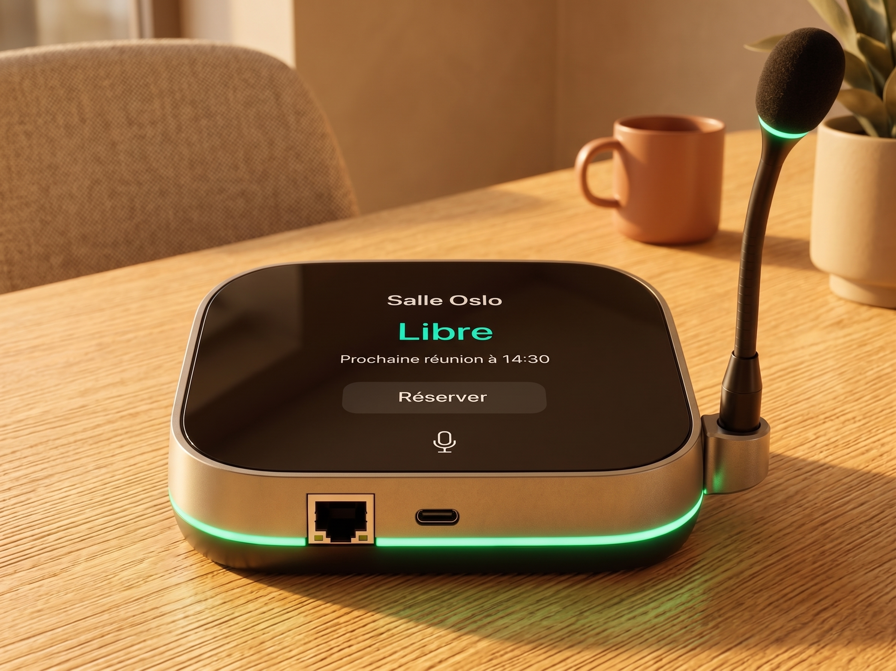

## Le produit {#produit}

OptiSpace est un système de gestion automatique des salles de réunion. Il associe un boîtier IoT installé dans chaque salle, une application web utilisable sur ordinateur et sur téléphone, un backend cloud et une couche d'analyse d'usage.

À l'heure de la réservation, le boîtier vérifie que quelqu'un est là. Une présence détectée suffit, sans aucun geste. Si personne n'est là, le réservant reçoit une notification. Sans présence à la fin du délai de grâce, le reste du créneau est libéré et redevient réservable par tous.

### Détection de présence

Une salle n'est comptée comme occupée que si quelqu'un s'y trouve vraiment. Les radars du boîtier détectent les personnes, même assises et immobiles. Un bouton sur l'écran permet aussi de signaler sa présence.

1. **Réservation** : à l'heure prévue, l'anneau passe à l'orange tant que personne n'est détecté.
2. **Présence** : dès qu'une présence est détectée, ou que quelqu'un appuie sur le bouton de l'écran, la salle passe en occupée (rouge).
3. **Absence au début** : si personne n'est là, le réservant est prévenu. Sans présence à la fin du délai de grâce, la salle est libérée.
4. **Départ en cours de réunion** : si la salle reste vide pendant le délai de grâce, le réservant est prévenu, puis le reste du créneau est libéré.
5. **Incertitude** : si le boîtier ne peut plus vérifier la présence, la salle n'est jamais libérée par erreur.

| Situation | Résultat |
|---|---|
| Quelqu'un arrive à l'heure | La présence est détectée et la réservation conservée, sans aucun geste |
| Personne n'arrive | Le réservant est prévenu, puis la salle est libérée à la fin du délai de grâce |
| Les participants partent avant la fin | Après le délai sans présence, le réservant est prévenu, puis le reste du créneau est libéré |
| Quelqu'un appuie sur le bouton de l'écran | Sa présence est prise en compte immédiatement |
| Le boîtier perd sa connexion | Aucune libération tant que la présence ne peut pas être vérifiée |
| Le réservant arrive après la libération | La réservation n'est pas restaurée ; il peut réserver de nouveau si la salle est libre |

### Libération automatique

Le créneau abandonné retourne dans les salles disponibles sans qu'un administrateur ait à intervenir. Les personnes qui cherchaient une salle sans en trouver sont prévenues. Le délai de grâce, 10 minutes par défaut, est réglé par le Facility Manager de l'entreprise.

### Statut lisible depuis le couloir

Un anneau LED indique l'état de la salle : vert pour libre, orange pour réservée en attente de présence, rouge pour occupée, bleu en cas d'incident. Pas besoin d'ouvrir son agenda.

### Application web, sur ordinateur et sur téléphone

Sans installation : les salles disponibles et occupées en temps réel, la réservation, les notifications, et une alerte quand une salle se libère. Les connecteurs Google Calendar et Microsoft Outlook sont prévus dans une version ultérieure.

### Tableau de bord d'occupation

Réservé au Facility Manager : taux d'occupation réel, temps moyen d'utilisation, salles les plus et les moins utilisées, réservations fantômes récurrentes, avec une synthèse et des recommandations générées par IA.

### Confidentialité par conception

Aucune caméra, aucun enregistrement audio ni vidéo, microphone désactivable physiquement.

- **Traitement du son 100 % local** : le boîtier ne calcule qu'un niveau sonore, au-dessus ou en dessous d'un seuil, sur quelques secondes. Le son brut n'est jamais stocké ni transmis.
- **Données envoyées par le boîtier** : uniquement des mesures anonymes, à savoir l'identifiant du boîtier, l'heure, la présence détectée ou non et l'appui sur le bouton. Aucune donnée nominative.
- **Durée de conservation** : réglée par le responsable désigné dans l'entreprise.
- **Accès aux statistiques** : les Facility Managers désignés par l'entreprise. Les administrateurs OptiSpace n'y accèdent que pour traiter des incidents et assurer la maintenance. Les collaborateurs voient seulement si chaque salle est libre ou occupée en temps réel.

---

## Fiche produit {#fiche}

Caractéristiques factuelles, à jour au 25 septembre 2027.

| Caractéristique | Détail |
|---|---|
| Nom commercial | OptiSpace |
| Type | Boîtier IoT de gestion de salle, application web (ordinateur et téléphone), service cloud avec analyse des résultats par IA |
| Détection de présence | Radars de présence, personnes immobiles comprises. Une présence détectée suffit ; bouton sur l'écran en complément |
| Interface | Écran tactile avec bouton de présence, anneau LED (vert, orange, rouge, bleu) |
| Caméra | Aucune |
| Microphone | Mesure un niveau sonore, calculé dans le boîtier. Désactivable physiquement. Aucun enregistrement, le son brut ne quitte jamais le boîtier. |
| Connectivité | Wi-Fi |
| Alimentation | USB-C |
| Installation | Pose sur table, aucun câblage réseau ni travaux |
| Dimensions | 14 × 14 × 23 cm, micro déployé |
| Prix du matériel | 150 € HT par boîtier, 40 € HT d'installation par salle |
| Abonnement | 39 € HT par mois et par salle jusqu'en 2028 |
| Disponibilité | 15 janvier 2027 |
| Distribution | Devis sur demande, directement depuis le site de 3istor Corp |
| Compatibilités | Application OptiSpace web, sur ordinateur et téléphone. Connecteurs Google Calendar et Microsoft Outlook prévus, pour s'intégrer aux gestionnaires de salles existants |

---

## Visuels haute définition {#visuels}

Téléchargeables directement, sans inscription ni formulaire.

Le boîtier se manipule en 3D ci-dessous.

  <model-viewer
    src="assets/models/optispace.glb"
    alt="Modèle 3D du boîtier OptiSpace, manipulable à la souris et au doigt"
    camera-controls
    touch-action="pan-y"
    auto-rotate
    rotation-per-second="18deg"
    shadow-intensity="1"
    exposure="1.1"
    environment-image="neutral">
  </model-viewer>
  

    Glisser pour tourner
    Molette pour zoomer
    <a href="assets/models/optispace.glb" download>Télécharger le .glb</a>
  

<h3 data-if-model hidden>Le boîtier en situation</h3>

  

    

      <ul class="carousel-track">
        <li class="carousel-slide" data-caption="En réunion : anneau rouge, la présence est détectée">
          
        </li>
        <li class="carousel-slide" data-caption="Anneau vert : la salle est libre et réservable">
          
        </li>
      </ul>
    

    1 / 2
    <button class="carousel-nav prev" type="button" aria-label="Visuel précédent">&lsaquo;</button>
    <button class="carousel-nav next" type="button" aria-label="Visuel suivant">&rsaquo;</button>
  

  

    
En réunion : anneau rouge, la présence est détectée

    

    <a class="carousel-dl" href="assets/images/objet/optispace-situation-01.png" download>Télécharger ce visuel</a>
  

> **Conditions d'utilisation**
>
> Visuels libres de droits pour usage éditorial, crédit : 3istor Corp. Toute utilisation commerciale ou publicitaire nécessite un accord écrit préalable. Les visuels ne doivent pas être modifiés autrement que par recadrage.

---

## L'équipe {#equipe}

Portraits téléchargeables, mêmes conditions d'utilisation que les visuels produit.

  

Arthur Presle

Développeur

  

Hugo Guillet

Chargé de presse et développeur

  

Joe Bejjani

Communication et développement

  

Newfel Levrel

CEO

  

Raphaël Ye

Développeur

  

Brian Peret

DevOps

---

## À propos de 3istor Corp {#entreprise}

Fondée en 2026 au Kremlin-Bicêtre par Newfel Levrel, 3istor Corp conçoit des solutions IoT dédiées à l'optimisation des espaces de travail. La société réunit six associés et déploie OptiSpace, son premier produit.

---

## Contact presse {#contact}

**Hugo GUILLET**, Chargé de presse 
[hugo.guillet@epita.fr](mailto:hugo.guillet@epita.fr), +33 7 32 76 10 92

Nous répondons aux demandes de visuels complémentaires, d'interview ou de test produit sous 48 heures ouvrées.

[Communiqué de presse (PDF)](assets/Communique_de_presse_OptiSpace_3istor_Corp_VF.pdf){: .btn .btn-primary download="download"}
